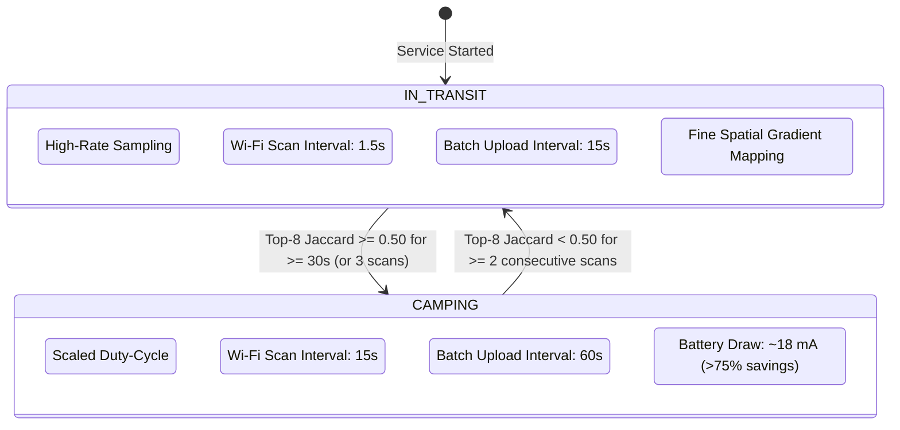

# Wi-Fi Indoor Environment Mapper (`wifi-nerf-mapper`)
> **Production-Ready Native Android Background RF, Inertial & Dwell Data Collector for Indoor NeRF & Floorplan Reconstruction**

A native Android data collection engine in Kotlin that transforms an unmodified smartphone into a synchronized multi-modal RF, inertial, and barometric mapping sensor—**running 100% in the background with the screen off and streaming directly to Oracle Cloud Infrastructure (OCI) Object Storage**.

Designed specifically for crowdsourced and fleet-wide indoor RF mapping, this repository provides the standalone mobile collector, multi-device fleet identity, 24/7 environment dwell clustering, adaptive duty-cycling, offline SQLite store-and-forward buffering, and serverless direct OCI Object Storage streaming.

*(For the cloud reconstruction pipeline, Pose-Graph SLAM, NeRF RF tomography solver, CAD floorplan vectorizer, and 2.5D interactive viewer, see the companion repository: [`wifi-nerf-reconstructor`](https://github.com/sky-45/wifi-nerf-reconstructor.git).)*

---

## Architecture Overview

```
wifi-nerf-mapper/
├── app/
│   ├── src/main/
│   │   ├── AndroidManifest.xml # ForegroundService + Wi-Fi/Sensors permissions
│   │   ├── res/values/
│   │   │   └── strings.xml     # Zero-code OCI Object Storage PAR configuration
│   │   └── java/com/antigravity/wifimapper/
│   │       ├── model/         # @Serializable data classes (NDJSON schema & DwellState)
│   │       ├── sync/          # PoseRingBuffer (Hardware CLOCK_BOOTTIME SLERP)
│   │       ├── collectors/    # PDR Tracker, Multi-Band Scanner, Link Prober, RTT Ranger, EnvironmentDwellManager
│   │       ├── cloud/         # DeviceIdentityManager, CloudBatchUploader (Direct OCI PAR / REST)
│   │       ├── service/       # BackgroundMappingService (PARTIAL_WAKE_LOCK & Duty-Cycling)
│   │       └── ui/            # Jetpack Compose HUD Dashboard & Friend Quick-Setup
│   └── build.gradle.kts       # App-level dependencies & plugins
├── scripts/
│   └── adb_setup_and_pull.sh  # Optional developer USB utility (ADB setup, offline spool sync)
├── build.gradle.kts           # Root Gradle build script
├── settings.gradle.kts        # Root Gradle settings
├── .gitignore
└── README.md
```

```mermaid
flowchart TD
    subgraph Mobile Device Collectors
        PDR[Inertial PDR Tracker<br/>200 Hz IMU + Mag + Baro] -->|Hardware BootTime SLERP| PRB[PoseRingBuffer]
        WIFI[Multi-Band Wi-Fi Scanner<br/>2.4 / 5 / 6 GHz Sweeper] -->|Retro-Interpolate Pose| DWELL[EnvironmentDwellManager<br/>Top-8 Jaccard & Dwell Clustering]
        PROBE[Connected Link Prober<br/>UDP RTT + RSSI + Link Speed] -->|Retro-Interpolate Pose| SPOOL
        RTT[Wi-Fi RTT Ranger<br/>802.11mc FTM ToF] -->|Retro-Interpolate Pose| SPOOL
        WIFI --> SPOOL[Local Flash Disk Spool<br/>Gzip NDJSON]
    end

    subgraph Identity & Duty-Cycling
        ID[DeviceIdentityManager<br/>Android Keystore MasterKey AES-256 UUID] --> SPOOL
        DWELL -->|State: CAMPING vs IN_TRANSIT| DUTY[Adaptive Duty-Cycle Scaling]
        DUTY -->|1.5s vs 15s Scan Interval| WIFI
        DUTY -->|15s vs 60s Batch Interval| UPLOAD[CloudBatchUploader]
    end

    subgraph Cloud Ingestion Modes
        SPOOL --> UPLOAD
        UPLOAD -->|Mode 1: PUT /fleet/{dev}/{env}/batch_{seq}.ndjson.gz| OCI[OCI Object Storage PAR<br/>Direct Serverless Ingest]
        UPLOAD -->|Mode 2: POST /api/v1/telemetry/batches| REST[REST Telemetry Gateway<br/>X-Device-Id / X-Environment-Id]
    end
```

---

## 1. Multi-Device Fleet Identification

In multi-phone crowd-mapping deployments, data collected by different devices must be reliably correlated, attributed, and partitioned without violating platform security policies or user privacy.

### Why Not IMEI or Wi-Fi MAC Address?
1. **Platform Security Restrictions (Android 10+ / API 29+)**:
   - `Build.getSerial()`, `TelephonyManager.getImei()`, and `getDeviceId()` are gated behind the privileged permission `READ_PRIVILEGED_PHONE_STATE`. This permission is reserved strictly for system applications signed by the device platform key; normal user-installed applications receive a fatal `SecurityException`.
   - Wi-Fi MAC addresses are randomized per network connection. Furthermore, calling `WifiInfo.getMacAddress()` always returns the hardcoded dummy value `02:00:00:00:00:00` to prevent cross-app tracking.
2. **Google Play Policy Compliance**:
   - Google Play Developer Distribution agreements strictly prohibit capturing non-resettable hardware identifiers for application tracking.

### Hardware-Backed Persistent UUID Architecture
`DeviceIdentityManager.kt` generates a cryptographically random UUIDv4 on first run and persists it using **Android Keystore-backed `EncryptedSharedPreferences`**:
- **Encryption Scheme**: AES-256 SIV for keys and AES-256 GCM for values, managed via Jetpack Security `MasterKey`.
- **Persistence Guarantees**: Stored securely on the device's internal private storage. Survives application restarts, background service recreation, phone reboots, and OTA OS updates. Resettable only on complete application uninstall.
- **Hardware Profile Snapshot**: Accompanies the UUID with an immutable snapshot of physical device capabilities:
  ```json
  {
    "device_id": "8f3e2b10-6c94-4d89-9a71-3b7c8e9f0123",
    "manufacturer": "Google",
    "model": "Pixel 8 Pro",
    "brand": "google",
    "device": "husky",
    "product": "husky",
    "hardware": "husky",
    "sdk_int": 34,
    "release": "14",
    "has_wifi_rtt": true,
    "has_accelerometer": true,
    "has_gyroscope": true,
    "has_compass": true,
    "has_barometer": true,
    "has_step_detector": true
  }
  ```

---

## 2. 24/7 Environment Dwell & Camping Lifecycle

To operate 24/7 without exhausting the device battery, the mapping engine clusters localized RF environments and dynamically scales sensor duty cycles based on user mobility.



### Top-8 Strongest BSSIDs
Indoor spaces (homes, offices, cafes) are characterized by the strongest access points. Distant APs fluctuating near the receiver noise floor (-85 dBm to -95 dBm) vary randomly due to multipath shadowing. `EnvironmentDwellManager.kt` extracts the **top-8 strongest unique BSSIDs** sorted by RSSI descending, discarding noise.

### Jaccard Index Clustering
Given the active cluster BSSID set $A$ and the newly scanned BSSID set $B$:
$$J(A, B) = \frac{|A \cap B|}{|A \cup B|}$$

- If $J(A, B) \ge 0.50$: The device is in the **same physical environment**. The cluster signature is maintained and incrementally updated.
- If $J(A, B) < 0.50$ across 2 consecutive scans: The device has moved to an adjacent room, walked out onto the street, or entered a new building.

### Canonical SHA-256 Environment ID
To ensure multiple phones visiting the same location produce identical cluster identifiers without exposing raw hardware MACs:
1. Sort the cluster's top BSSIDs lexicographically: `"AA:BB:CC:DD:EE:01|AA:BB:CC:DD:EE:02|..."`
2. Compute the SHA-256 digest.
3. Form the deterministic environment identifier: `env_{sha256_prefix}` (e.g., `env_b3a1c8f9210d4e5a`).

### Adaptive Duty-Cycle Scaling

| Metric / Parameter | `IN_TRANSIT` Mode | `CAMPING` Mode | Impact |
|:---|:---|:---|:---|
| **User Activity** | Walking, transit, hallway traversal | Desk work, sleeping, seated dwell | Continuous coverage |
| **Wi-Fi Scan Rate** | ~0.67 Hz (Every 1,500 ms) | ~0.067 Hz (Every 15,000 ms) | 10× scan reduction |
| **Batch Upload Rate** | Every 15,000 ms | Every 60,000 ms | 4× radio transmit reduction |
| **Connected Prober** | 100 ms UDP probe active | Suspended or reduced rate | Conserves link bandwidth |
| **Estimated Current** | ~78 mA (~1.7% battery / hr) | ~18 mA (~0.4% battery / hr) | **>75% battery savings** |

---

## 3. Configurable Cloud Provider Architecture

The telemetry engine features a store-and-forward architecture with dual-destination cloud uploaders configured in `CloudBatchUploader.kt`.

### Mode 1: OCI Object Storage via Pre-Authenticated Request (PAR)
Direct, serverless upload directly to Oracle Cloud Infrastructure Object Storage (or AWS S3-compatible buckets) without needing an intermediary application server.

- **Object Path Hierarchy**:
  ```
  https://objectstorage.{region}.oraclecloud.com/p/{par_token}/n/{namespace}/b/{bucket}/o/fleet/{device_id}/{environment_id}/batch_{seq}.ndjson.gz
  ```
- **HTTP Method**: `PUT` (standard S3/OCI Object Storage object upload) or `POST`.
- **Request Headers**:
  ```http
  PUT /fleet/8f3e2b10-6c94-4d89-9a71-3b7c8e9f0123/env_b3a1c8f9210d4e5a/batch_42.ndjson.gz HTTP/1.1
  Host: objectstorage.us-ashburn-1.oraclecloud.com
  Content-Type: application/x-ndjson
  Content-Encoding: gzip
  X-Device-Id: 8f3e2b10-6c94-4d89-9a71-3b7c8e9f0123
  X-Environment-Id: env_b3a1c8f9210d4e5a
  X-Dwell-State: CAMPING
  X-Session-Id: a3f890b1-4d32-41ce-bb42-10f78912d001
  X-Batch-Id: batch_9921_a4b0c1
  X-Batch-Seq: 42
  ```

### Mode 2: Standard REST Telemetry Ingestion Server
Ingestion into a centralized processing pipeline (e.g., Python FastAPI, Go, or Node backend):

- **Endpoint**: `POST /api/v1/telemetry/batches`
- **Request Headers**:
  ```http
  POST /api/v1/telemetry/batches HTTP/1.1
  Host: telemetry.mapper.internal:8000
  Authorization: Bearer <auth_token>
  Content-Type: application/x-ndjson
  Content-Encoding: gzip
  X-Device-Id: 8f3e2b10-6c94-4d89-9a71-3b7c8e9f0123
  X-Environment-Id: env_b3a1c8f9210d4e5a
  X-Dwell-State: IN_TRANSIT
  X-Session-Id: a3f890b1-4d32-41ce-bb42-10f78912d001
  X-Batch-Id: batch_9921_a4b0c1
  X-Batch-Seq: 42
  ```

### Store-and-Forward Zero Data Loss Guarantee
Every batch is serialized, compressed with Gzip, and written to flash storage (`filesDir/telemetry_spool/batch_{device}_{env}_{seq}_{id}.ndjson.gz`) **before** any network transmission begins. Spool files are unlinked only after a `2xx` HTTP response is received. If the phone traverses a Wi-Fi dead zone, batches accumulate on disk and upload automatically upon reconnect.

---

## 4. Exact NDJSON Schema Specifications

Each batch payload is a Gzipped Newline-Delimited JSON (`.ndjson.gz`) file.
- **Line 1 is ALWAYS the `batch_envelope`**, containing the fleet device ID, environment ID, dwell state, hardware battery stats, and sequence index.
- **Lines 2..N are polymorphic `TelemetryEvent` records**, each with hardware CLOCK_BOOTTIME nanosecond timestamps and SLERP retro-interpolated 6-DoF poses.

### Batch Envelope (`batch_envelope`)
```json
{
  "event_type": "batch_envelope",
  "timestamp_ns": 1700000015000000000,
  "session_id": "a3f890b1-4d32-41ce-bb42-10f78912d001",
  "device_id": "8f3e2b10-6c94-4d89-9a71-3b7c8e9f0123",
  "environment_id": "env_b3a1c8f9210d4e5a",
  "dwell_state": "CAMPING",
  "batch_seq": 42,
  "start_time_ns": 1700000000000000000,
  "end_time_ns": 1700000014900000000,
  "event_count": 87,
  "battery_pct": 84,
  "battery_current_ua": -185000,
  "step_count_delta": 24,
  "pose": {
    "x": 4.12,
    "y": 2.85,
    "z": 0.0,
    "qx": 0.0, "qy": 0.0, "qz": 0.382, "qw": 0.924,
    "confidence": 0.95,
    "is_stationary": true
  }
}
```

### Multi-Band Wi-Fi Scan Batch (`wifi_scan_batch`)
```json
{
  "event_type": "wifi_scan_batch",
  "timestamp_ns": 1700000001500000000,
  "device_id": "8f3e2b10-6c94-4d89-9a71-3b7c8e9f0123",
  "environment_id": "env_b3a1c8f9210d4e5a",
  "dwell_state": "CAMPING",
  "scans": [
    {
      "bssid": "a4:97:b1:12:34:50",
      "ssid": "HomeNet",
      "ap_group_id": "a4:97:b1:12:34:xx-HomeNet",
      "band": "2.4GHz",
      "freq_mhz": 2437,
      "bw_mhz": 20,
      "rssi_dbm": -48,
      "is_80211mc": false,
      "hw_timestamp_ns": 1700000001460000000,
      "scan_age_ms": 40,
      "pose": {"x": 4.12, "y": 2.85, "z": 0.0, "qx": 0.0, "qy": 0.0, "qz": 0.382, "qw": 0.924, "confidence": 0.95, "is_stationary": true}
    },
    {
      "bssid": "a4:97:b1:12:34:54",
      "ssid": "HomeNet_5G",
      "ap_group_id": "a4:97:b1:12:34:xx-HomeNet",
      "band": "5GHz",
      "freq_mhz": 5180,
      "bw_mhz": 80,
      "rssi_dbm": -55,
      "is_80211mc": true,
      "hw_timestamp_ns": 1700000001490000000,
      "scan_age_ms": 10,
      "pose": {"x": 4.12, "y": 2.85, "z": 0.0, "qx": 0.0, "qy": 0.0, "qz": 0.382, "qw": 0.924, "confidence": 0.95, "is_stationary": true}
    }
  ],
  "multiband_pairs": [
    {
      "ap_group_id": "a4:97:b1:12:34:xx-HomeNet",
      "rssi_24_dbm": -48,
      "rssi_5_dbm": -55,
      "excess_wall_loss_db": 0.44
    }
  ],
  "pose": {"x": 4.12, "y": 2.85, "z": 0.0, "qx": 0.0, "qy": 0.0, "qz": 0.382, "qw": 0.924, "confidence": 0.95, "is_stationary": true}
}
```

### Connected AP High-Rate Probing (`connected_probe`)
```json
{
  "event_type": "connected_probe",
  "timestamp_ns": 1700000002100000000,
  "device_id": "8f3e2b10-6c94-4d89-9a71-3b7c8e9f0123",
  "environment_id": "env_b3a1c8f9210d4e5a",
  "dwell_state": "CAMPING",
  "bssid": "a4:97:b1:12:34:54",
  "freq_mhz": 5180,
  "rssi_dbm": -54,
  "tx_mbps": 866,
  "rx_mbps": 780,
  "udp_rtt_ms": 2.15,
  "pose": {"x": 4.12, "y": 2.85, "z": 0.0, "qx": 0.0, "qy": 0.0, "qz": 0.382, "qw": 0.924, "confidence": 0.95, "is_stationary": true}
}
```

### Wi-Fi RTT 802.11mc FTM Ranging (`wifi_rtt`)
```json
{
  "event_type": "wifi_rtt",
  "timestamp_ns": 1700000002600000000,
  "device_id": "8f3e2b10-6c94-4d89-9a71-3b7c8e9f0123",
  "environment_id": "env_b3a1c8f9210d4e5a",
  "dwell_state": "CAMPING",
  "bssid": "a4:97:b1:12:34:54",
  "mode": "TWO_SIDED_80211MC",
  "distance_mm": 3840,
  "std_dev_mm": 115,
  "rssi_dbm": -54,
  "attempted": 8,
  "successful": 8,
  "pose": {"x": 4.12, "y": 2.85, "z": 0.0, "qx": 0.0, "qy": 0.0, "qz": 0.382, "qw": 0.924, "confidence": 0.95, "is_stationary": true}
}
```

### Inertial PDR, Magnetometer & Barometer (`mag_baro_pdr`)
```json
{
  "event_type": "mag_baro_pdr",
  "timestamp_ns": 1700000003000000000,
  "device_id": "8f3e2b10-6c94-4d89-9a71-3b7c8e9f0123",
  "environment_id": "env_b3a1c8f9210d4e5a",
  "dwell_state": "CAMPING",
  "mag_uncal_ut": [18.4, -22.1, 41.5],
  "mag_norm_ut": 49.85,
  "pressure_hpa": 1013.25,
  "step_detected": true,
  "stride_length_m": 0.68,
  "is_stationary": false,
  "pose": {"x": 4.12, "y": 2.85, "z": 0.0, "qx": 0.0, "qy": 0.0, "qz": 0.382, "qw": 0.924, "confidence": 0.95, "is_stationary": false}
}
```

---

## 5. Downstream Reconstruction & Cloud Processing

The batches collected by this app and streamed to your OCI Object Storage bucket are processed by the companion cloud solver:
👉 **[`sky-45/wifi-nerf-reconstructor`](https://github.com/sky-45/wifi-nerf-reconstructor.git)**

The reconstructor performs:
- **Multi-Device Rigid Alignment:** SVD Procrustes SE(2) coordinate transformation to merge data from multiple friends into one coordinate frame.
- **Pose-Graph SLAM & Free-Space Carving:** Gyroscope drift correction and walkable area stamping.
- **Multi-AP Localization:** Pinning router coordinates and transmission power $P_0$.
- **Two-Tier Physics Inversion:** FISTA Sparse Tomography + NeRFMap Coordinate MLP with Fourier features.
- **CAD Vectorization & 2.5D Web Viewer:** Outputting `.geojson`, `.json`, and interactive HTML floorplans.

---

## 6. Building, Cloud Setup & Distribution to Friends

### 6.1 Zero-Code Cloud Configuration (OCI Bucket / PAR)
Before building, configure your storage backend directly in `app/src/main/res/values/strings.xml`:
```xml
<resources>
    <!-- Set to "OCI_PAR" for direct serverless upload into Oracle Cloud Object Storage -->
    <string name="cloud_provider_mode">OCI_PAR</string>
    <!-- Your Pre-Authenticated Request (PAR) Object prefix URL from OCI Console -->
    <string name="cloud_upload_url">https://objectstorage.<region>.oraclecloud.com/p/<token>/n/<namespace>/b/<bucket_name>/o/batches/</string>
    <string name="cloud_auth_token"></string>
</resources>
```
With this set, every phone built with this APK automatically streams encrypted Gzip batches into your bucket under `batches/<device_id>/...` with zero client-side authentication or API keys required.

---

### 6.2 Option A: Direct Distribution to Friends (No PC / No ADB Needed)
This is the recommended approach to share the app with friends, colleagues, or survey testers.

#### 1. Build the Standalone APK
From the repository root in your terminal:
```bash
./gradlew assembleDebug
```
*(On Windows: `gradlew.bat assembleDebug`, or in Android Studio: **Build > Build Bundle(s) / APK(s) > Build APK(s)**)*.

The resulting standalone file is located at:
`app/build/outputs/apk/debug/app-debug.apk` (you can rename it to `WifiMapper.apk`).

#### 2. Share the File
Send `WifiMapper.apk` to your friends via **WhatsApp, Telegram, Google Drive, OneDrive, or Email**.

#### 3. What Your Friends Do on Their Phones (30 Seconds)
1. **Tap & Install**:
   - Tap the received `WifiMapper.apk` file.
   - If prompted with *"Your phone is not allowed to install unknown apps from this source"*, tap **Settings** &rarr; toggle on **Allow from this source** &rarr; tap **Install**.
2. **Launch & Grant Standard On-Screen Permissions**:
   - Open **Wi-Fi Mapper**. Android will prompt with standard system dialogs:
     - **Location**: Choose *"While using the app"* or *"All the time"*.
     - **Physical Activity**: Tap *"Allow"* (for dead-reckoning step tracking).
     - **Notifications**: Tap *"Allow"* (keeps the background service alive in the status bar).
3. **One-Tap Optimizations (Right in the App)**:
   - **"24/7 Battery" Button**: Opens the system prompt to exclude the app from battery killing so it maps with the screen locked in their pocket.
   - **"Scan Throttling" Button** *(Optional, for 10x faster scans)*: Opens Developer Options directly on their screen. They just toggle off **"Wi-Fi scan throttling"**. *(If developer options are not active yet, tap "Build Number" 7 times in Phone Settings &rarr; About Phone)*.
4. **Start Mapping**:
   - Tap **START BACKGROUND SERVICE**, lock the phone, and pocket it.
   - Each friend automatically receives a cryptographically unique `device_id` (`DeviceIdentityManager.kt`). All batches sync to your OCI bucket tagged with their device ID. If they lose cell/Wi-Fi signal, data buffers locally in SQLite and uploads when connection returns.

---

### 6.3 Option B: Developer / USB ADB Installation (Power Users)
If you are developing locally with a test phone connected via USB:

```bash
# 1. (Optional) Disable Wi-Fi scan throttling via ADB terminal
bash scripts/adb_setup_and_pull.sh setup

# 2. Build & Install directly via ADB from repository root
./gradlew assembleDebug
adb install -r app/build/outputs/apk/debug/app-debug.apk
```
